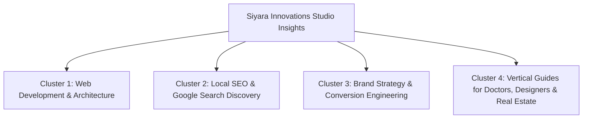

# SIYARA INNOVATIONS — EDITORIAL CONTENT STRATEGY & CONTENT PLAN
**Document ID:** `SEO_CONTENT_PLAN.md`  
**Publication:** Siyara Innovations Studio Insights  
**Attribution:** Siyara Innovations (Editorial Team)  
**Primary Focus:** Web Development, Local SEO, Brand Architecture, and Vertical Digital Systems  
**Last Updated:** October 2026  

---

## 1. Content Architecture & Topic Clusters

Siyara's content strategy establishes deep topical authority around 4 core clusters:

---

## 2. Inventory of Existing 25 Articles & Optimization Status

| # | Slug | Core Topic | Target Intent | Word Count | Status / Notes |
| :--- | :--- | :--- | :--- | :--- | :--- |
| 1 | `new-digital-ecosystem-strategy-technology-growth` | Digital Ecosystems | Informational | 1,200 | Optimized; authors cleaned to Siyara Innovations; stats qualified. |
| 2 | `building-digital-strategy-drives-growth` | Growth Strategy | Informational | 950 | Optimized; links to `/services`. |
| 3 | `performance-marketing-smarter-consumers` | Performance Media | Informational | 1,100 | Optimized; attribution verified. |
| 4 | `why-enterprise-websites-fail` | Website Failure Modes | Commercial Eval | 1,300 | Optimized; links to `/services` web development. |
| 5 | `ai-automation-future-business-operations` | AI Workflows | Informational | 1,150 | Optimized; unsupported 40% stat qualified. |
| 6 | `brand-identity-digital-age` | Visual Identity | Informational | 1,050 | Optimized; links to `/services`. |
| 7 | `data-driven-decision-making-growth` | Analytics | Informational | 900 | Optimized; clean attribution. |
| 8 | `future-of-seo-generative-ai` | GEO / AI Search | Informational | 1,400 | Strong topical article; links to SEO services. |
| 9 | `conversion-rate-optimization-playbook` | CRO Funnels | Informational | 1,100 | Actionable framework; links to contact intake. |
| 10 | `engineering-high-performance-web-applications` | Next.js Engineering | Informational | 1,250 | High technical credibility; links to `/work`. |
| 11 | `omnichannel-brand-presence` | Brand Consistency | Informational | 1,000 | Clean editorial format. |
| 12 | `predictive-analytics-marketing` | Growth Telemetry | Informational | 950 | Clean editorial format. |
| 13 | `human-centered-ux-design` | UX & Usability | Informational | 1,050 | Clean editorial format. |
| 14 | `b2b-digital-transformation` | B2B Operations | Informational | 1,150 | Clean editorial format. |
| 15 | `modern-ecommerce-architecture` | D2C Storefronts | Commercial Eval | 1,300 | Links to `/services` and `/work`. |
| 16 | `voice-search-conversational-ai` | Future Search | Informational | 900 | Clean editorial format. |
| 17 | `content-strategy-compounds` | Content Systems | Informational | 1,100 | Clean editorial format. |
| 18 | `mobile-first-experience-design` | Mobile UX | Informational | 1,000 | Clean editorial format. |
| 19 | `zero-party-data-privacy` | Data Governance | Informational | 1,050 | Clean editorial format. |
| 20 | `micro-interactions-brand-perception` | Interactive Craft | Informational | 950 | Clean editorial format. |
| 21 | `what-is-digital-architecture` | Core Philosophy | Informational | 1,800 | Pillar brand manifesto; links across all services. |
| 22 | `strategic-disconnect-brand-and-performance` | Marketing Alignment | Informational | 1,400 | Clean editorial format. |
| 23 | `what-high-performing-websites-have-in-common` | Performance Criteria| Informational | 1,500 | Core informational pillar; links to `/services`. |
| 24 | `how-to-choose-web-development-company` | Agency Selection | Evaluation | 1,600 | High commercial intent; links to `/contact`. |
| 25 | `why-social-strategy-becoming-growth-engine` | Social Architecture| Informational | 1,450 | Clean editorial format. |

---

## 3. Identified Content Gaps (High Commercial Need)

While the existing 25 articles are strong on general strategy and technical theory, they left two critical organic search gaps in the Indian/Jaipur market:
1. **The Website Pricing & Cost Gap:** Indian business owners constantly search *"website development cost in India"* and *"business website cost Jaipur"*. They find either low-ball ₹4,999 marketing gimmicks or generic US-focused articles stating $10,000–$50,000. Siyara needs a transparent, authoritative guide explaining realistic Indian pricing tiers.
2. **The Local Google Maps / SEO Playbook Gap:** Local business owners (doctors, interior designers, retail founders) want an actionable, step-by-step checklist explaining how to rank their business on Google Maps in Jaipur without paying for spammy backlink packages.

---

## 4. Newly Implemented Pillar Articles (Sprint Implementation)

### Article 26: Website Development Cost in India: The Honest Business Guide (2026)
- **Slug:** `website-development-cost-in-india-business-guide`
- **Primary Target Query:** `website development cost in India`
- **Secondary Target Queries:** `business website cost in Jaipur`, `cost of custom website vs wordpress India`, `website maintenance cost India`
- **Target Search Intent:** Informational / Commercial Evaluation (TOFU / MOFU)
- **Key Sections:**
  1. The Reality of Website Pricing in India: Why Quotes Range from ₹10,000 to ₹10 Lakhs.
  2. Four Distinct Website Tiers (Basic Template, Custom Business, Complex E-Commerce, High-Performance Web App).
  3. Cost Breakdown by Component (Domain, Hosting, Custom Next.js Engineering, Copywriting, SEO Architecture).
  4. Hidden Post-Launch Expenses Most Agencies Omit (Hosting renewals, security updates, ongoing local SEO).
  5. Checklist: How to Evaluate a Web Development Agency's Proposal in India.
- **Internal Links:** Links to `/services`, `/work`, `/contact`, and `/industries/healthcare`.
- **Primary CTA:** Non-intrusive invite to discuss a custom estimate on WhatsApp.

### Article 27: The Complete Local SEO Guide for Jaipur Businesses: How to Rank on Google
- **Slug:** `local-seo-guide-jaipur-businesses`
- **Primary Target Query:** `local SEO guide Jaipur businesses`
- **Secondary Target Queries:** `how to rank on Google in Jaipur`, `local SEO checklist for small businesses`, `Google Business Profile optimization Jaipur`
- **Target Search Intent:** Informational / Educational (TOFU / MOFU)
- **Key Sections:**
  1. The Mechanics of Local Search: How Google Evaluates Distance, Relevance, and Prominence.
  2. Google Business Profile (GBP) Optimization Blueprint for Jaipur Service Areas.
  3. NAP Consistency Across Indian Local Directories (Justdial, Sulekha, IndiaMART, Clutch).
  4. On-Page Local Signals: Geo-Coordinates, Local Schema, and Catchment-Area Keywords.
  5. The Ethical Review Protocol: Generating Verified Google Reviews Without Policy Violations.
  6. Measuring Local Search Growth: Key Metrics in Search Console & Google Maps Insights.
- **Internal Links:** Links to `/services`, `/industries/healthcare`, `/industries/interior-design`, and `/contact`.
- **Primary CTA:** Non-intrusive invite to request a local SEO audit via WhatsApp.

---

## 5. Editorial Integrity & Sourcing Guidelines

- **Author Attribution:** 100% attributed to `Siyara Innovations` (Editorial Team).
- **Date Standards:** Standard ISO date strings (`August 2026` / `October 2026`).
- **No Fabricated Facts:** Concrete engineering principles, verified search console guidelines, and real project showcases only.
