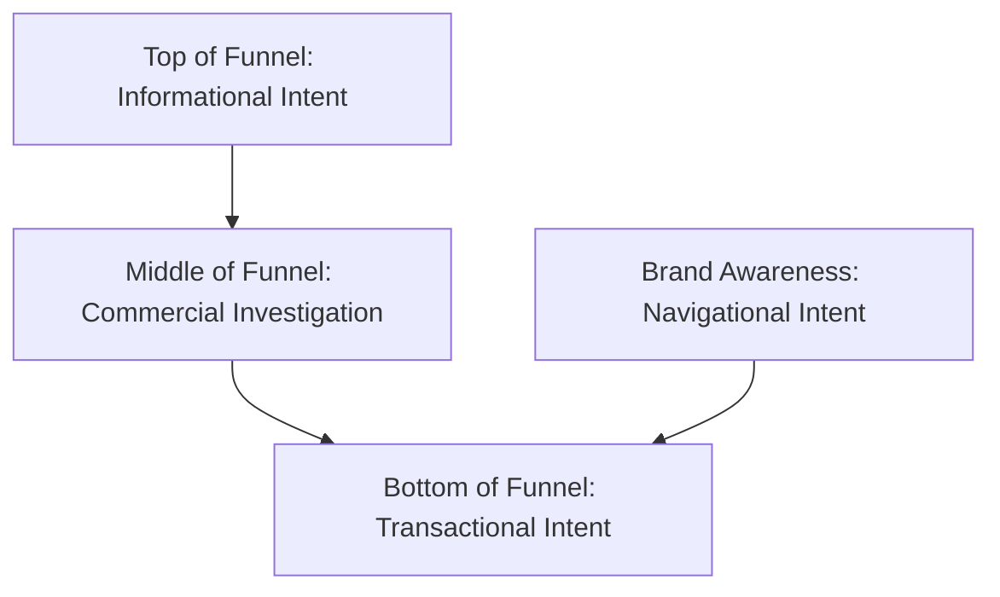

# SIYARA INNOVATIONS — SEARCH INTENT & CONVERSION FUNNEL MAP
**Document ID:** `SEO_SEARCH_INTENT_MAP.md`  
**Framework:** 4-Tier Search Intent Taxonomy (Navigational, Informational, Commercial Investigation, Transactional)  
**Target Geo:** Jaipur, Rajasthan, India  
**Last Updated:** October 2026  

---

## 1. Intent Mapping Overview

Search intent defines what a prospective client expects to find when querying Google. Matching search intent is the single most important ranking and conversion factor. Ranking a generic sales page for an informational query results in immediate bounces; conversely, providing a 3,000-word article for an urgent transactional query loses high-intent leads.

---

## 2. Intent-to-Page Funnel Architecture

| Funnel Stage | Search Intent Type | Typical User Queries | Target URLs | Primary Content Delivered | Primary Conversion Action (CTA) |
| :--- | :--- | :--- | :--- | :--- | :--- |
| **Top of Funnel (TOFU)** | **Informational** | - *website development cost in India* - *local SEO checklist for small businesses* - *how to choose a web development company* - *what a business website needs* | `/blog/*` `/blog/website-development-cost-in-india-business-guide` `/blog/local-seo-guide-jaipur-businesses` | In-depth educational guides, actionable checklists, diagnostic criteria, transparent cost tables. | "Read Article" / "Explore Our Approach" / "WhatsApp: Ask a Specific Question" |
| **Middle of Funnel (MOFU)** | **Commercial Investigation** | - *best web design agency in Jaipur* - *SEO services Jaipur comparison* - *website design for doctors Jaipur* - *real estate website development Jaipur* | `/services` `/industries/*` `/work` | Industry-specific case studies, feature comparisons, deliverables breakdown, interactive client showcases. | "View Industry Work" / "WhatsApp: Discuss Your Project" |
| **Bottom of Funnel (BOFU)** | **Transactional** | - *hire web development company Jaipur* - *contact SEO company in Jaipur* - *Jaipur digital agency consultation* | `/contact` `/` `/services#contact` | Fast 3-field intake form, instant WhatsApp click-to-chat with prefilled text, clear response turnaround time (under 24 hours). | "Book Strategy Session" / "WhatsApp: +91 95872 69209" |
| **Brand (All Stages)** | **Navigational** | - *siyara innovations* - *siyara digital* - *siyara digital agency jaipur* | `/` `/about` | Homepage hero with verified brand positioning, About page detailing Jaipur studio philosophy and methodology. | "Start a Project" / "Explore Our Work" |

---

## 3. Detailed Search Intent Personas (Siyara Core Verticals)

### Persona A: The Healthcare / Clinic Director (Mansarovar / C-Scheme, Jaipur)
- **Primary Search Queries:** *"website design for doctors Jaipur"*, *"clinic website development"*, *"SEO for dental clinic Jaipur"*.
- **Search Intent:** Commercial Investigation transitioning to Transactional.
- **Pain Points:** Outdated clinic websites, lack of mobile appointment scheduling, poor Google Maps visibility when patients search "dentist near me" or "skin clinic Jaipur".
- **Required Content Match:** Professional, HIPAA/privacy-conscious layout, appointment-funnel architecture, doctor credential presentation, and local Google Business Profile optimization.
- **Assigned Landing URL:** `https://www.siyaradigitals.com/industries/healthcare`
- **Primary CTA:** *"Discuss Clinic Web System on WhatsApp"*

---

### Persona B: The Luxury Real Estate Developer / Broker (Jaipur & NCR)
- **Primary Search Queries:** *"real estate website development Jaipur"*, *"website design for real estate businesses"*, *"property showcase website design"*.
- **Search Intent:** High-Intent Commercial.
- **Pain Points:** Generic real estate listings that fail to convey prestige; low-converting lead forms for multi-crore villas and luxury apartments.
- **Required Content Match:** High-speed visual gallery, interactive floor-plan previews, location map integration, brochure download capture, and fast lead qualification.
- **Assigned Landing URL:** `https://www.siyaradigitals.com/industries/real-estate`
- **Primary CTA:** *"Request Real Estate Digital Architecture Brief"*

---

### Persona C: The Boutique Interior Designer / Architecture Studio (Jaipur)
- **Primary Search Queries:** *"website design for interior designers"*, *"architectural website design Jaipur"*, *"portfolio website for interior design"*.
- **Search Intent:** Commercial Investigation.
- **Pain Points:** Slow, heavy WordPress portfolio sites that compress photography poorly or take 6+ seconds to load on mobile.
- **Required Content Match:** Editorial typography, crisp retina photography optimization, project categorization by aesthetic style, and seamless client inquiry paths.
- **Assigned Landing URL:** `https://www.siyaradigitals.com/industries/interior-design`
- **Primary CTA:** *"Explore Interior Portfolio Architecture on WhatsApp"*

---

### Persona D: The Event Management & Wedding Planner (Rajasthan)
- **Primary Search Queries:** *"event management company website development"*, *"wedding planner website design Jaipur"*, *"luxury event portfolio website"*.
- **Search Intent:** Commercial / Transactional.
- **Pain Points:** Inability to showcase grand destination wedding visuals and high-profile corporate galas with cinematic elegance; missed inquiries from overseas destination wedding clients.
- **Required Content Match:** Full-screen visual storytelling, video background support, celebration case studies, vendor coordination features, and instant WhatsApp inquiry.
- **Assigned Landing URL:** `https://www.siyaradigitals.com/industries/event-management`
- **Primary CTA:** *"Start Event Platform Consultation on WhatsApp"*

---

### Persona E: The Small Business Owner / Manufacturer (Jaipur)
- **Primary Search Queries:** *"website development cost in India"*, *"local SEO checklist for small businesses"*, *"web development company in Jaipur"*.
- **Search Intent:** Informational moving into Commercial Evaluation.
- **Pain Points:** Fear of getting overcharged by agencies; uncertainty regarding domain, hosting, maintenance, and whether SEO actually works.
- **Required Content Match:** Honest, transparent pricing breakdowns, actionable local SEO checklists, and zero jargon.
- **Assigned Landing URLs:** `/blog/website-development-cost-in-india-business-guide` & `/blog/local-seo-guide-jaipur-businesses`
- **Primary CTA:** *"Get a Custom Project Estimate via WhatsApp"*

---

## 4. Intent Integrity Guidelines (Rules for Siyara Pages)

1. **No Keyword Cannibalization:** Never assign the exact same primary search query to multiple pages. Each page must have one distinct primary search intent.
2. **Never Mislead Informational Readers:** If a visitor arrives seeking "cost of website development in India", provide genuine figures, price tiers, and trade-offs before presenting any service pitch.
3. **Keep Transactional Routes Ultra-Lean:** The contact page (`/contact`) must focus purely on swift enquiry completion: minimal inputs, instant WhatsApp option, zero distractions.
